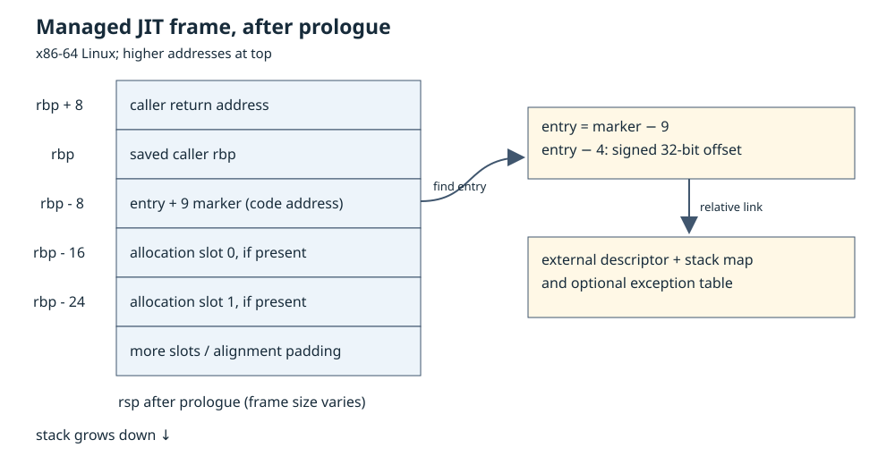

# [ABI INFO] Managed stack frames on x86-64 Linux

Scope: source snapshot inspected 2026-11-23; the concrete layout below is the current x86-64 JIT's ordinary compiled-function frame, not every runtime stub, interpreter frame, or native compiler output. The runtime also documents this marker convention for x86 managed frames. Frame contents change across calls and prologues; never infer GC roots merely from a word's position.



```text
higher addresses
  [rbp+8]       caller return address
  [rbp]         saved caller rbp                 <- rbp / frame address
  [rbp-8]       entry+9 marker (a code address, not metadata)
  [rbp-16]      allocation slot 0, if present
  [rbp-24]      allocation slot 1, if present
  ...           further slots / alignment padding
                 <- rsp after the prologue
lower addresses

entry-4: signed relative descriptor offset --> external descriptor / stack map
```

`CompileFunction::MakePrologue` emits `push rbp` (1 byte), `mov rbp,rsp` (3), and a five-byte relative `call` to its immediately following label. The call pushes `entry+9` at `[rbp-8]`; `FrameInfo::GetFuncStartPC` subtracts 9. The four bytes *before* entry encode a descriptor-relative link; the descriptor is not a stack word. `MakeEpilogue` sets `rsp=rbp`, pops `rbp`, and returns. This description applies after the prologue completes, not while it is partially executed.

For `N` allocator slots, the JIT reserves `F = align_up(8*(N+1), 16)` bytes below `rbp`, counting the marker; after the marker call it subtracts `F-8` if necessary. Slot `i` is at `rbp-8*(i+2)`, for `0 <= i < N`. For example, `N=2` gives `F=32`, marker at -8, slots at -16 and -24, and 8 bytes of alignment padding. Oversized frames and unrepresentable signed slot offsets fail compilation. Call setup can temporarily change `rsp`; this is not a universal fixed-SP diagram.

Incoming stack argument `i` is at `rbp + 16 + 8*i`. `StackFrameUtils::GetIncomingArgumentOffset` shares the signed-displacement check among compiled parameters, hidden TypeInfo parameters, and resolver-stub stack roots.

The frame pointer chain and saved return addresses permit stack walking; safepoint-specific stack maps identify roots and saved-register details, not a fixed per-frame object layout. See [generated-code metadata](abi-code-metadata.md), [stack growth](abi-stack-growth.md), and [exceptions](abi-exceptions.md). Resolver and transition stubs have their own layouts; native code generation and other architectures must be checked separately.

Sources (paths relative to sibling repositories): `cangjit/src/JIT/X86_64/Compilers/Function/CompileFunction.cpp` (`MakePrologue`, `MakeEpilogue`, `CompileToAddress`); `cangjit/src/JIT/X86_64/Utils/StackFrameUtils.cpp` (`GetFrameSize`, `GetSlotOffset`); `cangjie_runtime/runtime/src/Common/StackType.h` (`MachineFrame`, `FrameInfo::GetFuncStartPC`).
